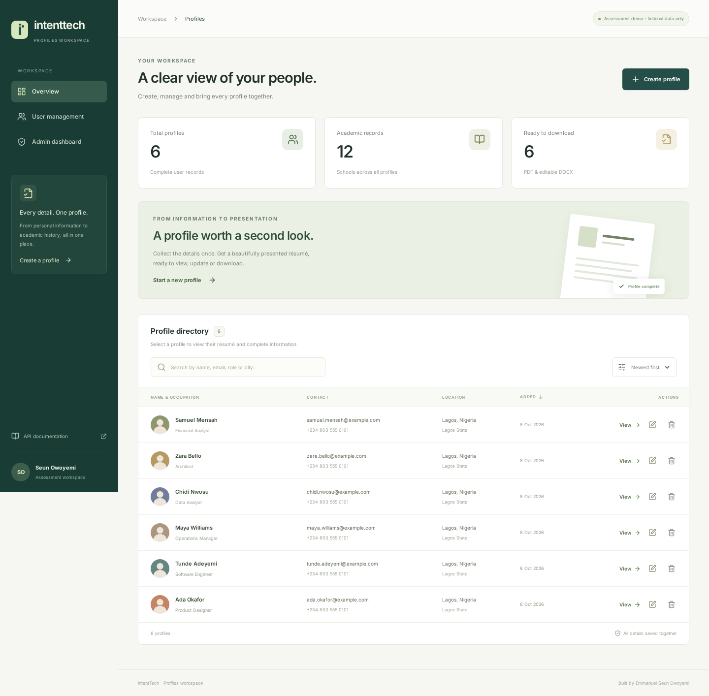
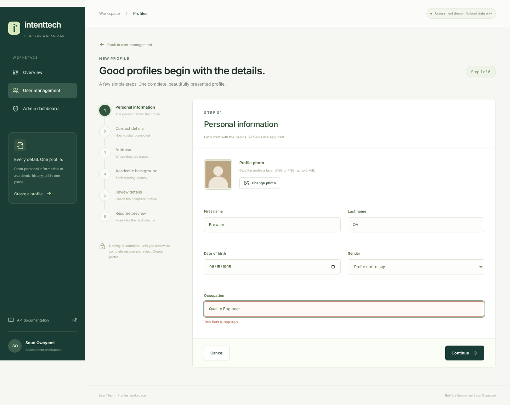
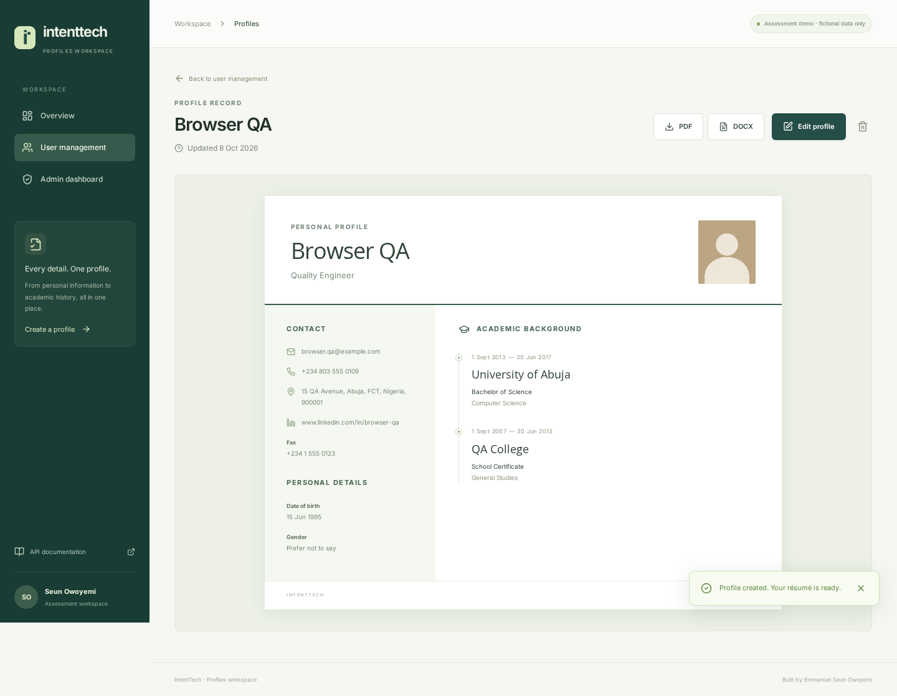
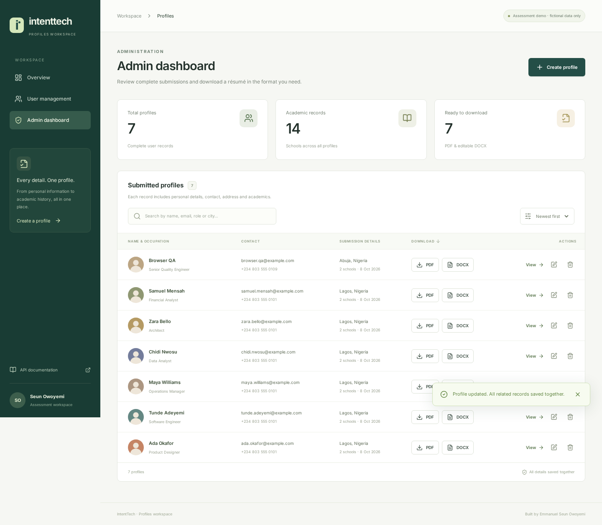

# IntentTech Profiles

Full-stack developer assessment by **Emmanuel Seun Owoyemi**. A React and TypeScript workspace for creating, managing and exporting complete personal profiles through a NestJS API backed by PostgreSQL.

The application supports the complete CRUD journey, a six-step validated wizard, résumé views, an admin dashboard and PDF/editable DOCX downloads. A submission uses **one HTTP request with four nested objects**. All related writes execute in one database transaction.

## Quick start

Requires Node.js 22+ and npm. Run all commands from the repository root.

```bash
npm ci
cp .env.example .env
```

Use native PostgreSQL 16+ for the assessment deployment. Docker can start the database and API together:

```bash
docker compose up --build -d
npm run seed
npm run dev -w client
```

Open the frontend at **http://localhost:5173**, Swagger at **http://localhost:3000/api/docs**, and the health check at **http://localhost:3000/api/health**. The seed command adds six fictional profiles and preserves existing records.

Without Docker, start a development-only embedded PostgreSQL engine in one terminal:

```bash
npm run dev:db
```

Then in another terminal:

```bash
npm run seed
npm run dev
```

This fallback uses PGlite (PostgreSQL compiled to WASM) with the PostgreSQL wire protocol. It is **not the production database** and needs `DATABASE_POOL_SIZE=1`. The API itself always uses TypeORM's PostgreSQL driver and `pg`. The deployment and Docker configurations use native PostgreSQL.

## Assessment coverage

| Requirement                        | Implementation                                                                         |
| ---------------------------------- | -------------------------------------------------------------------------------------- |
| NestJS, TypeScript, PostgreSQL     | Nest controllers/services, TypeORM `DataSource`, `pg`, versioned SQL migration         |
| Four objects in one create request | `userInfo`, `userContact`, `userAddress`, `userAcademics`                              |
| Save to four related tables        | One transaction inserts personal info, contact, address and ordered school rows        |
| Five CRUD endpoints                | POST, GET list, GET one, PUT, DELETE                                                   |
| React Hook Form and wizard         | Six steps with field validation, photo upload and repeatable schools                   |
| Last steps show résumé             | Step 5 reviews the complete résumé; step 6 shows the final résumé before submission    |
| Redux Toolkit                      | Redux store and RTK Query for requests, loading/error state, caching and invalidation  |
| TypeScript, hooks, Tailwind        | Typed React components, hooks, Tailwind 4 with custom design tokens                    |
| User management                    | Directory, search, sort, view, prefilled edit wizard, confirmed delete                 |
| Single user résumé                 | Full personal, contact, address and academic information                               |
| Admin dashboard                    | Every submitted profile, links to full information and per-record download controls    |
| PDF and editable DOCX              | Server-generated PDFKit document and native Word paragraphs, table, headings and image |
| Required AI use                    | ChatGPT/Codex assisted implementation and verification; see `docs/AI_USAGE.md`         |

## Architecture

`client/` contains React 19, Vite, React Hook Form, Zod, Redux Toolkit/RTK Query, React Router, Tailwind CSS and Lucide icons. `server/` contains the NestJS application, DTOs, validation, TypeORM entities, migrations, transaction services and export services.

The browser submits the complete aggregate. The API validates and normalizes it, decodes and verifies the photo, then uses the transaction's entity manager for **every write and the final read**. An error in any table rolls back the entire operation. The UI navigates to the persisted profile only after the API confirms success.

The migration preserves the exact table names in the test, including spaces and spelling:

| Table             | Relationship                                                      |
| ----------------- | ----------------------------------------------------------------- |
| `UserInfoTB`      | Profile root, UUID primary key, timestamps                        |
| `UserContactTB`   | One-to-one, `userId` primary/foreign key, unique normalized email |
| `User addressTB`  | One-to-one, `userId` primary/foreign key                          |
| `UserAcamesicsTB` | One-to-many school records, ordered by `position`                 |

Deleting the root cascades to all child tables. A unique `(userId, position)` constraint preserves school ordering. Updates lock the root row, replace contact/address fields, replace the school list, and commit as one transaction. `synchronize` is disabled; the versioned migration runs at startup.

## API

| Method | Path                  | Behavior                                  |
| ------ | --------------------- | ----------------------------------------- |
| POST   | `/api/users`          | Create a complete aggregate; 201          |
| GET    | `/api/users`          | List complete profiles, newest first; 200 |
| GET    | `/api/users/:id`      | Fetch one complete profile; 200           |
| PUT    | `/api/users/:id`      | Replace all four groups atomically; 200   |
| DELETE | `/api/users/:id`      | Delete profile and related data; 204      |
| GET    | `/api/users/:id/pdf`  | Download PDF résumé                       |
| GET    | `/api/users/:id/docx` | Download editable Word résumé             |
| GET    | `/api/health`         | Check database connectivity               |
| GET    | `/api/docs`           | Interactive Swagger                       |
| GET    | `/api/openapi.json`   | OpenAPI specification                     |

POST and PUT accept the same four-object model:

```json
{
  "userInfo": {
    "profilePhoto": "data:image/jpeg;base64,<valid image bytes>",
    "firstName": "Ada",
    "lastName": "Okafor",
    "dob": "1993-06-15",
    "occupation": "Product Designer",
    "gender": "Female"
  },
  "userContact": {
    "email": "ada@example.com",
    "phoneNumber": "+234 803 555 0101",
    "fax": "",
    "linkedInUrl": "https://www.linkedin.com/in/ada-example"
  },
  "userAddress": {
    "address": "12 Example Avenue",
    "city": "Lagos",
    "state": "Lagos State",
    "country": "Nigeria",
    "zipCode": "100001"
  },
  "userAcademics": {
    "schools": [
      {
        "schoolName": "University of Lagos",
        "qualification": "Bachelor of Science",
        "fieldOfStudy": "Industrial Design",
        "startDate": "2011-09-01",
        "endDate": "2015-06-30"
      }
    ]
  }
}
```

Use the wizard to upload a valid photo; the illustrative photo value above must be replaced with real JPEG/PNG base64 bytes. The response adds `id`, `createdAt` and `updatedAt`. PUT is complete aggregate replacement, not a partial patch. Empty/omitted optional fax, LinkedIn and school end dates are stored as null and returned as empty strings.

Validation rejects unknown fields, missing nested objects, empty required strings, invalid emails/phone numbers, unsafe or unrelated LinkedIn URLs, invalid/future dates, schools predating birth, reversed school dates, and school lists outside 1–20 entries. Photos are verified by decoding, capped at 2 MiB and 25 megapixels, oriented correctly, resized and normalized to JPEG. Email uniqueness is enforced by PostgreSQL; conflicts return 409. Invalid input returns 400; absent profiles return 404.

## Verification

```bash
npm run build
npm run typecheck
npm run test:embedded
npm run test:browser
```

The API integration suite covers all CRUD operations, related table row counts, strict validation, email conflicts, cascades, exports and Swagger. It also injects an academic-table constraint failure to verify **full rollback on both create and update**.

For native PostgreSQL verification, create a dedicated database whose name ends in `_test`, set `TEST_DATABASE_URL`, and run `npm test`. Tests truncate only that explicitly isolated database. Do not point it at a production database.

The browser runner starts its own isolated database, NestJS API and frontend; it tests the real wizard, school add/remove behavior, edit, exports, admin, delete cancellation/confirmation and mobile navigation. Linux tests use an npm-bundled Chromium; on other platforms install Playwright Chromium with `npx playwright install chromium`. It saves review screenshots in `docs/screenshots/` and results under ignored `test-results/`.

See `docs/VERIFICATION.md` for the completed checks and the limits of this environment. No hosted deployment is claimed until live endpoints have been checked.

## Deployment

See `docs/DEPLOYMENT.md` for Railway PostgreSQL/API and Vercel frontend configuration. `server/Dockerfile`, `railway.json`, `client/vercel.json`, environment examples and `compose.yaml` are included.

## Scope and tradeoffs

This is a small, reviewable assessment demo. There is no account/login requirement in the supplied test, so the user and admin views are intentionally open for evaluation and the UI asks reviewers to use fictional data. Real personal-data use would require authentication, role permissions, retention rules and audit logging before launch.

Photos are stored in PostgreSQL as normalized data URLs to keep the four-table implementation self-contained. For a larger system, put images in object storage and add server-side pagination/search with summary-only list responses. The current list includes the complete aggregate, which is useful for this small dataset but not intended for thousands of profiles. A database pool of 10 is the production default; embedded tests use one connection and do not prove native PostgreSQL concurrency behavior.

## Screenshots





